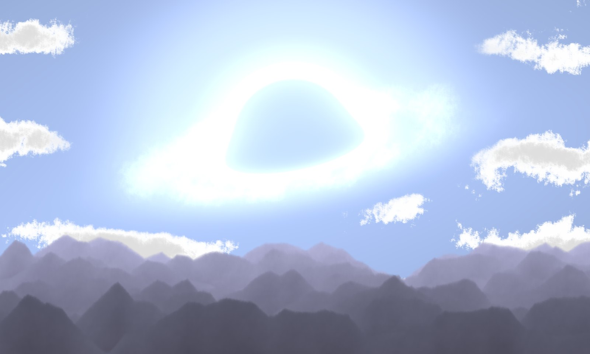
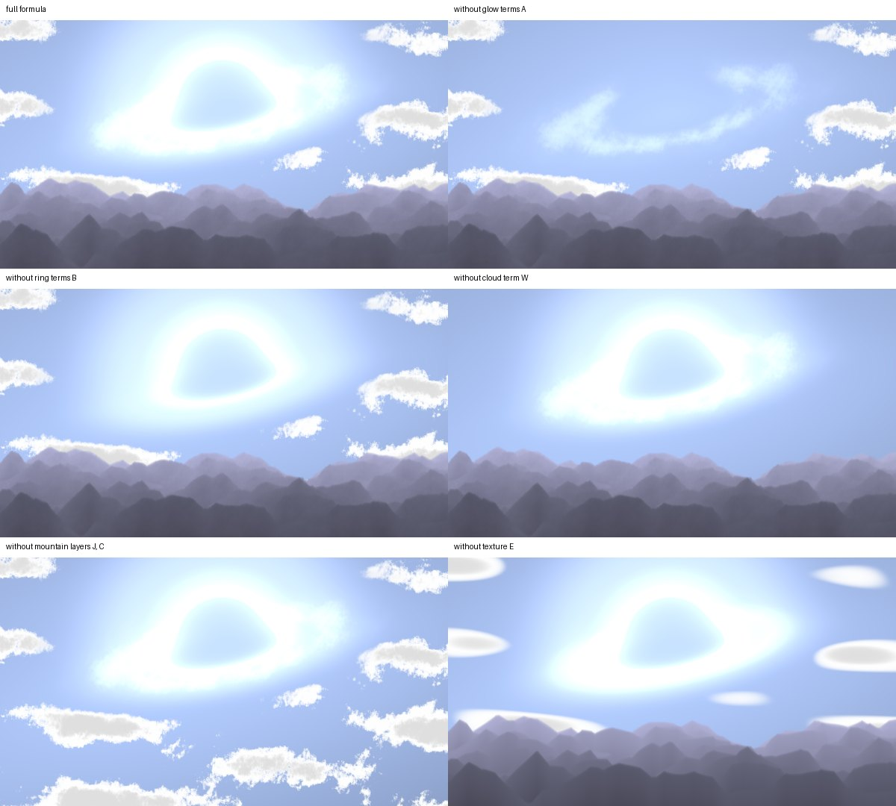
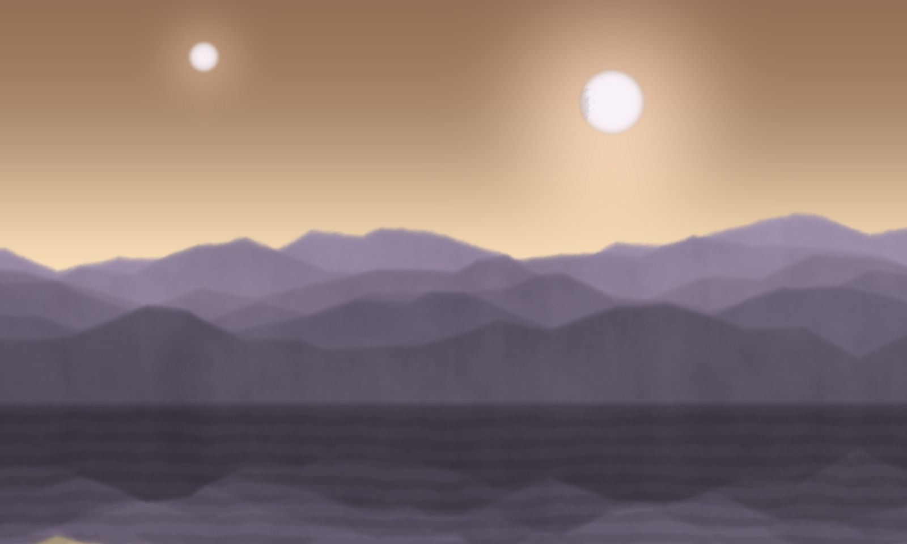

# Formula pictures

Pictures that are equations: every pixel is computed from a formula, so the figure can be
checked the way a proof can.

Jeromie Beasley · Atlas Memoriae · ORCID [0009-0006-4645-5643](https://orcid.org/0009-0006-4645-5643)

*AI-assisted. The ideas and research direction are the author's; AI tools were used for
computation, coding, drafting and narration (see [AI_USE.md](AI_USE.md)).*

## See the formula become a picture

[**Read the illustrated PDF · 5 pages**](yeganeh/writeup/how-the-black-hole-equation-is-built-v2.pdf) ·
[**Watch the narrated ring · 63 seconds**](ring-video/ring_keeps_two_books_narrated_v2.mp4) ·
[**Watch the silent ring · 24 seconds**](ring-video/ring_keeps_two_books_v1.mp4)

### 1. Reproduce the black hole



*Original formula and picture by Hamid Naderi Yeganeh. Reproduced here to explain how its terms build the image.*

### 2. Take the formula apart



*Switch off one group of terms at a time and see what disappears.*

### 3. Build a new scene with the same mathematical tools



*Two moons over a mountain lake at dusk — Jeromie Beasley’s new scene, built using Yeganeh’s mathematical grammar.*

The route through this project is **reproduce → take apart → rebuild → check**.
The scripts and reported checks are below.

## How the black-hole equation is built

How does Hamid Naderi Yeganeh ([@naderi_yeganeh](https://x.com/naderi_yeganeh)) write formulas like *View of a Black Hole from a
Planet*, in which one equation gives the colour of every pixel? The answer here is a sequence of five scripts you can run.

| Script | What it does | Result |
|---|---|---|
| [`render.py`](yeganeh/render.py) | Renders his printed formula exactly, 2000 × 1200 | reproduces the published picture |
| [`checks.py`](yeganeh/checks.py) | Checks two identities of the grammar | the layer weights sum to 1 (error 4×10⁻¹⁶); cloud roughness exponent 0.472 |
| [`anatomy.py`](yeganeh/anatomy.py) | Switches off one group of terms at a time | each group draws exactly one element of the picture |
| [`new_scene_v2.py`](yeganeh/new_scene_v2.py) | Writes a new picture with nothing but the same eight operations | *Two moons over a mountain lake at dusk* |
| [`transcription_check.py`](yeganeh/transcription_check.py) | Re-implements the new formula from its written form and compares | 0 differences in 2,400,000 pixels |

The eight building blocks: soft step e^(−e^(−kz)); AND by adding inner exponentials; shapes as level
sets; glow bands around a level set; folds arccos(cos θ) for ridges; a fractal texture sum;
a painter's chain of layers ∏(1−J_u)·J_s; colour as a quadratic in the channel number.
The final output step is F = ⌊255·clamp⌋.

[Read the illustrated PDF](yeganeh/writeup/how-the-black-hole-equation-is-built-v2.pdf),
or [download the HTML explainer](https://github.com/dicipler-pixel/formula-pictures/raw/refs/heads/main/yeganeh/writeup/index.html)
and open it in a browser. The explainer runs no scripts; keep its three images alongside it
by downloading the [complete repository](https://github.com/dicipler-pixel/formula-pictures/archive/refs/heads/main.zip).

Each script takes about 25–30 seconds on a laptop and writes its PNG next to itself.

```
cd yeganeh
python3 render.py
python3 checks.py
python3 anatomy.py
python3 new_scene_v2.py
python3 transcription_check.py   # run after new_scene_v2.py
```

## The ring keeps two books

The twisted ring of Section 7 of *Non-normality is connection energy, and its opposite*
(Jeromie Beasley, v15, [doi:10.5281/zenodo.22803572](https://doi.org/10.5281/zenodo.22803572)),
drawn with the same grammar. Five sites; a twist d is wound in. Each edge holds a fixed budget
of 8, split between the connection book 4(1 − cos x) (amber) and its opposite 4(1 + cos x)
(cyan). The outer circle is the whole ring's account, with a white mark at the floor
min_w 4N(1 − cos((d − 2πw)/N)). At d = π the two windings tie; the field keeps its winding
until about d = 2.75π, then slips one winding and settles back on the floor.

* [Watch the silent ring](ring-video/ring_keeps_two_books_v1.mp4) — 24 s.
* [Watch the narrated ring](ring-video/ring_keeps_two_books_narrated_v2.mp4) — 63 s, narrated (Kokoro, voice am_michael).
* [Download the narrated MP4](https://github.com/dicipler-pixel/formula-pictures/raw/refs/heads/main/ring-video/ring_keeps_two_books_narrated_v2.mp4).

To rebuild them:

```
cd ring-video
python3 ring_video.py simulate          # the flow, about 1 s
python3 ring_video.py render 0 1        # 577 frames into frames/, about 2.4 s per frame
ffmpeg -framerate 24 -i frames/f%04d.png -c:v libx264 -crf 18 -pix_fmt yuv420p silent.mp4

# narrated cut: put kokoro-v1.0.onnx and voices-v1.0.bin in ring-video/models/
# (from the model-files-v1.0 release of github.com/thewh1teagle/kokoro-onnx), or set KOKORO_DIR
python3 narrate.py
python3 ring_video_v2.py plan
python3 ring_video_v2.py audio
python3 ring_video_v2.py render 0 1     # 1524 frames into frames_v2/
ffmpeg -framerate 24 -i frames_v2/f%04d.png -i voice/narration_v2.wav -c:v libx264 -crf 18 \
       -pix_fmt yuv420p -c:a aac -shortest narrated.mp4
```

`render <worker> <nworkers> [max_frames]` splits the frames between processes: run
`render 0 2` and `render 1 2` side by side on two cores. Add a third number to render only the
first few frames as a test.

What the motion is, stated plainly: a downhill flow of the connection energy kept to the ring
family (fields in one plane), with a small noise to break the ring's symmetry. It is not the
author's relaxation flow, which leaves the ring family. The lag from π to about 2.75π and the
slip landing on one edge are what this run did; they were not tested across settings.

## Credits

* **Hamid Naderi Yeganeh** ([@naderi_yeganeh](https://x.com/naderi_yeganeh) on X) created *View of a Black Hole from a Planet* and the way of writing a
  whole picture as one formula: the pixel convention that turns row n and column m into a point
  (x, y), the soft steps, layers and colour polynomials, and the final step that turns each value
  into a pixel colour. Everything in `yeganeh/` reads his work, and the ring video borrows his
  grammar. His formula and the images rendered from it remain his (see [NOTICE](NOTICE)).

## Requirements

Python 3 with NumPy and Pillow; `soundfile` and `kokoro-onnx` for the narration; FFmpeg to make
the MP4s. The titles use TeX Gyre Pagella and Heros if installed, otherwise DejaVu.

## Licence

Code: MIT OR Apache-2.0, at your option. Text, the two-moons image and the videos: CC BY 4.0.
Yeganeh's formula and every image rendered from it are his and are not covered; see
[LICENSE](LICENSE) and [NOTICE](NOTICE).
