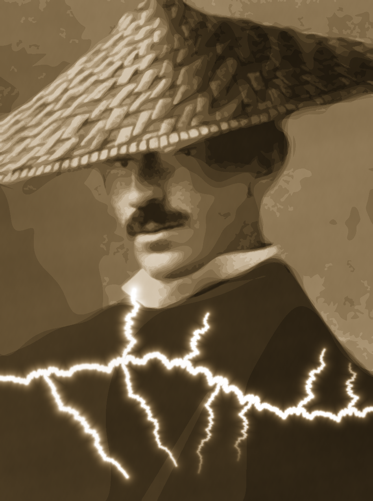

# Mona Tesla v5 — The Equations Are the Picture

Formula artwork and coefficient set: **Jeromie Beasley**.
Animation, implementation, and video assembly: ChatGPT.
Narration: **Kokoro-82M**, voice `af_heart`, via `kokoro-onnx`.

[**Watch the 3:31 Kokoro explainer**](Mona_Tesla_v5_Explainer_Kokoro.mp4) · [Download MP4](https://github.com/dicipler-pixel/formula-pictures/raw/refs/heads/main/mona-tesla-v5/Mona_Tesla_v5_Explainer_Kokoro.mp4) · [Complete equations](mona_tesla_sheet_v5.md)



The 1920 × 1080, 24 fps explainer shows:

1. A complete Fourier epicycle chain tracing a contour.
2. An enlarged contour with all 64 terms: one constant translation and 63 rotating circles.
3. All 651 chains running together: 41,013 rotating circles plus 651 offsets.
4. Nonzero-winding polygon regions and their stored positive/negative signs.
5. All 13 cumulative contour-tone layers, separately.
6. The 15 computed lightning paths and their brightness field.
7. The prescribed 29-wave grain and the Perron colour mapping.
8. The completed portrait and credits.

## Rebuild the video

Install Python packages from `requirements.txt` and install ffmpeg. On Linux, install the DejaVu fonts (or change FONT/BOLD in make_video.py to your installed fonts).

Run from this directory:

```bash
python make_video.py
```

The included `narration.wav` and `timeline.json` preserve the actual Kokoro narration and its timing. No model download is needed to reuse that recording. The video is written to `Mona_Tesla_v5_Explainer_Kokoro.mp4`.

`python make_video.py --preview` generates scene inspection frames without encoding a video. `python make_video.py --prepare-only` reconstructs the mathematical layers and final image.

To regenerate narration, install `kokoro-onnx==0.6.1`, download a compatible Kokoro ONNX model and voices file, then run:

```bash
python narrate.py --model /path/to/kokoro-v1.0.onnx --voices /path/to/voices-v1.0.bin
```

The Kokoro model weights are not included. Model project: https://huggingface.co/hexgrad/Kokoro-82M . ONNX runtime project: https://github.com/thewh1teagle/kokoro-onnx . The voice used in this video was generated locally from the Kokoro v1.0 int8 model, with the `af_heart` voice at speed 0.98.

## Exact construction

The two original input files are included without modification. `mona_tesla_sheet_v5.md` specifies the complete equations and `mona_tesla_formula_v5.json` supplies their coefficients.

Each Fourier polygon is evaluated at exactly 2048 samples. The winding fill uses integer pixel positions at the native 948 × 1270 resolution. The renderer clips scanline intervals before writing them; intervals with no visible width are discarded. This fixes the renderer-only streak bug without changing any input equations or coefficients.

The 13 tone layers are accumulated in the supplied scalar logit field before the sigmoid. The lightning uses the nearest of the prescribed 901 sample points on each bolt, the specified envelope and cutoff, and maximum aggregation. Grain and RGB mapping follow the supplied formulas.

The scene transitions interpolate between completed stages for explanation; the contours, their coefficients, and every completed stage are computed. The native final image was verified pixel-for-pixel against the corrected portrait renderer. The image shown inside the video is resized to fit the video layout.

Small circles are drawn at their actual scale, so some are smaller than one display pixel. The enlarged example makes the mechanism easier to inspect. The constant frequency-zero term translates the chain and is not counted as a rotating circle.

The five displayed equations abbreviate the full specification for readability. `Delta lambda_j` means the adjacent band logit difference in the sheet. Winding is computed on the sampled polygon. The equations in the video do not replace or simplify the supplied computation.

## Included material

- `make_video.py`: mathematical layer reconstruction and all animation code.
- `narrate.py`: Kokoro generation and scene timing.
- `mona_tesla_formula_v5.json`, `mona_tesla_sheet_v5.md`: original sources.
- `narration.wav`, `narration.srt`, `timeline.json`: actual voice recording, scene subtitles, and timing.
- `Mona_Tesla_v5.png`: exact final native portrait.
- `requirements.txt`: dependencies for video regeneration; Kokoro requirements listed separately.

## Repository licence

The repository licences apply: code MIT OR Apache-2.0; original text, coefficients, artwork, video, and narration CC BY 4.0. Credit Jeromie Beasley. Kokoro model weights are not included. See [LICENSE](../LICENSE), [NOTICE](../NOTICE), and [AI_USE.md](../AI_USE.md).

Verify the distributed files with `sha256sum -c SHA256SUMS`.
